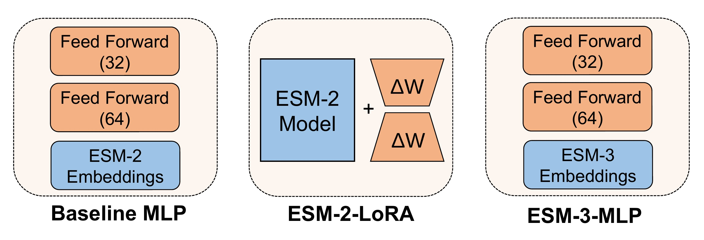

<p align="center">
  
</p>

# TmProt

Predict the melting temperature (Tm) of a protein from its sequence with protein language models.
Code, trained models and data for:

> Pailozian K et al. *Investigation of Protein Melting Temperature Prediction with Cross-Method Validation on Biophysical Data.* 2026. https://doi.org/10.64898/2026.05.07.723192

**Just want predictions?** Use the web server: https://huggingface.co/spaces/loschmidt/tmprot (paste or upload a FASTA file).

## Models

| Strategy | Model | Needs |
|---|---|---|
| `baseline_mlp` | frozen ESM-2 (650M) embeddings + MLP | a GPU is faster, CPU works |
| `esm2_lora` | ESM-2 (650M) fine-tuned with LoRA (this is TmProt 1.0) | a GPU for training |
| `esm3_mlp` | ESM-3 sequence embeddings + MLP | a free ESM-3 API token (see `.env.example`) |

The deployed TmProt 1.0 is the six-epoch `esm2_lora` adapter, seed 42.

<p align="center">
  
</p>

## Install

```bash
conda env create -f environment.yaml
conda activate tmprot
pip install -e .
```

## Get the data

The datasets, predictions and trained adapters are on Zenodo (https://zenodo.org/records/24196854).

```bash
python scripts/setup_data.py                                # training sets + six evaluation sets
python scripts/setup_data.py --datasets predictions adapters   # optional: predictions and the three LoRA adapters
```

Files land in `data/meltome/processed/` (train, validation and test; Meltome Atlas, CC0) and
`data/evaluation_sets/<set>/raw/` (BRENDA, FireProt, ERED-WT, ERED-ASR, CAS, HLD).
ProTherm is not redistributed; it is available from [ProThermDB](https://web.iitm.ac.in/bioinfo2/prothermdb/).

## Train

```bash
python src/scripts/train.py                     # ESM-2 + LoRA, settings in conf/training/esm_lora.yaml
python src/scripts/train.py lora_alpha=2 lr=1e-4   # override any setting on the command line
python src/scripts/run_strategies.py --strategies baseline_mlp   # or esm2_lora, esm3_mlp, or all
```

## Predict

With the command-line tool (the six-epoch adapter is bundled):

```bash
cd tmprot-1.0 && pip install -e . && cd ..
tmprot --input proteins.fasta --outdir predictions --threshold 60
```

Output: one CSV with the predicted Tm of each protein and whether it is at or above the threshold.
Sequences longer than 1022 residues are truncated to their first 1022 (an ESM-2 limit).

To score your own CSV (columns `ProteinID`, `sequence`, `Tm`) with a trained adapter:

```bash
python src/scripts/predict_dataset.py --inputs data/evaluation_sets/brenda/raw/BRENDA.csv \
    --model_dir models/esm2_lora_1024_6ep_s42 --outdir predictions/brenda
```

## Licence

GPL-3.0, see `LICENSE`. The datasets on Zenodo are CC BY 4.0.
